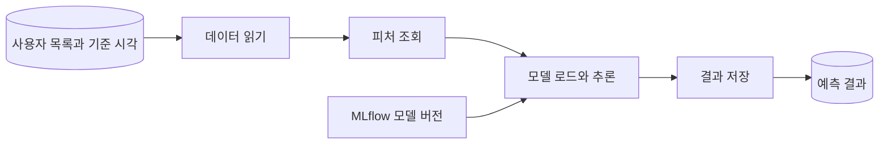

# Orchestrating ML Pipelines

## Reproducible Workflows

실험을 재현하려면 데이터와 모델을 관리하고 실행 과정도 명확히 정의해야 한다. 작업 순서가 달라지거나 이전 실행에서 남은 파일을 잘못 읽으면 같은 코드로도 다른 결과가 나올 수 있다.

노트북에서 직접 실행하던 작업을 정기적으로 반복하려면 각 단계의 입력과 출력을 정해야 한다. 실패한 단계를 찾아 원인을 확인할 수 있어야 하고, 재실행할 때 다른 실행의 데이터가 섞이지 않도록 해야 한다. 워크플로 오케스트레이터가 이런 작업의 순서와 의존성, 실행 상태를 관리한다.

Kubeflow Pipelines(KFP)는 ML 작업을 컴포넌트로 나누고 Kubernetes에서 실행한다. 입력과 출력을 연결해 파이프라인을 구성하고, 실행 상태와 로그, 산출물을 단계별로 확인할 수 있다. 소득 분류 실습에서는 MLflow에 등록한 모델과 Feast의 피처로 배치 추론을 수행한다.

## The Income Classifier Pipeline

파이프라인을 사용자 목록 읽기, 피처 조회, 모델 추론, 결과 저장의 네 단계로 구성한다.



| 단계 | 입력 | 출력 |
| --- | --- | --- |
| 데이터 읽기 | 객체 저장소의 사용자 목록 | 사용자 ID와 기준 시각을 담은 Dataset |
| 피처 조회 | 사용자 Dataset과 피처 목록 | 모델 입력 피처 Dataset |
| 모델 추론 | 피처 Dataset과 모델 버전 | 사용자별 예측 Dataset |
| 결과 저장 | 예측 Dataset과 저장 위치 | 저장된 결과 |

예측 결과에는 사용자 ID와 사용한 모델 버전을 함께 남긴다. 입력 데이터의 버전과 KFP 실행 기록도 보관해 결과가 달라졌을 때 실행 조건을 확인할 수 있도록 한다.

## Components and Artifacts

KFP의 [Component](https://www.kubeflow.org/docs/components/pipelines/concepts/component/)에는 작업의 입력과 출력, 실행 환경을 정의한다. 같은 작업이 필요하면 여러 파이프라인에서 재사용할 수 있다. Pipeline에서 Component를 호출할 때마다 실행할 작업인 Task가 생성된다.

모델 버전이나 저장 위치처럼 작은 설정값은 Parameter로, 데이터 파일은 Artifact로 전달한다. 사용자 목록과 피처, 예측 결과는 KFP의 [Dataset 타입](https://www.kubeflow.org/docs/components/pipelines/user-guides/data-handling/data-types/)으로 표현할 수 있다.

각 작업은 별도의 컨테이너에서 실행된다. 한 작업에서 만든 파일을 다음 작업에 전달하려면 Artifact의 출력과 입력을 연결한다. KFP는 이 연결에 따라 실행 순서를 결정한다.

## Connecting the Pipeline

데이터 읽기, 피처 조회, 추론, 저장을 각각 컴포넌트로 정의한다. 그런 다음 `outputs`로 각 작업의 출력을 다음 작업의 입력에 연결한다.

```python
@dsl.pipeline(name="income-classifier")
def income_pipeline(input_uri: str, output_uri: str, model_uri: str):
    data = read_data(input_uri=input_uri)
    features = retrieve_features(entities=data.outputs["output"])
    predictions = run_inference(
        features=features.outputs["output"],
        model_uri=model_uri,
    )
    write_data(
        predictions=predictions.outputs["output"],
        output_uri=output_uri,
    )
```

피처 조회가 끝나야 추론을 시작하고, 예측 결과가 준비돼야 저장 작업을 실행한다. KFP는 [컴포넌트 사이의 연결](https://www.kubeflow.org/docs/components/pipelines/user-guides/components/compose-components-into-pipelines/)에서 이러한 의존성을 확인한다.

`model_uri`에는 `models:/income-classifier/7`처럼 모델 버전이 포함된 URI를 지정한다. 추론 작업은 Kubernetes의 공용 MLflow 서버에서 전처리를 포함한 모델을 불러온다. 객체 저장소와 Feast에 접속할 때 필요한 인증 정보는 작업 Pod의 환경 설정으로 전달한다.

파이프라인을 컴파일해 KFP에 등록한 뒤 각 Task의 로그와 산출물을 확인한다. 사용자별로 피처가 올바르게 조회됐는지, 예측 결과에 사용자 ID와 모델 버전이 남아 있는지 살펴본다.

## Retries and Caching

네트워크 연결이 잠시 끊겼다면 재시도로 복구할 수 있다. 반면 피처 열이 없거나 자료형이 잘못된 경우에는 입력이나 코드를 수정해야 한다. 결과 저장을 재시도할 때는 같은 결과가 중복 적재되지 않도록 저장 경로와 덮어쓰기 정책도 정한다.

입력 데이터, 피처 정의, 모델, 이미지의 버전을 고정하면 KFP의 [캐시](https://www.kubeflow.org/docs/components/pipelines/user-guides/core-functions/caching/)로 이전 결과를 재사용할 수 있다. 같은 URI에서 데이터 내용이 바뀔 수 있다면 데이터 버전도 입력으로 전달해 변경 여부를 구분해야 한다.
