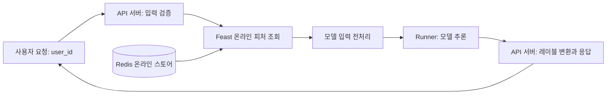
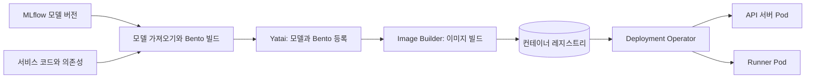
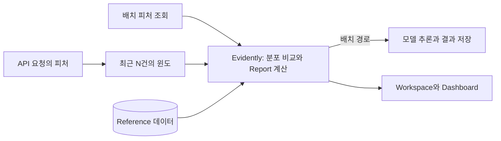

# Productionizing ML Models

## From Pipelines to APIs

5장에서는 사용자별로 피처를 조회하고 예측 결과를 저장하는 배치 파이프라인을 구성했다. 요청을 받는 즉시 예측해야 하는 서비스에서는 모델을 API로 제공해야 한다. 같은 소득 분류 모델이라도 실행 방식에 따라 입력을 받는 방법과 운영 조건이 달라진다.

API로 모델을 제공하려면 입력 검증, 피처 조회, 전처리, 모델 실행, 응답 생성을 연결해야 한다. 모델 파일과 함께 이 로직과 실행 환경을 관리하고, 요청이 늘어났을 때 서비스를 확장할 수 있어야 한다. BentoML은 이 서빙 애플리케이션을 정의하고 배포 가능한 형태로 패키징한다.

배포한 뒤에는 서비스 상태와 데이터의 변화를 함께 관찰해야 한다. API가 정상 응답해도 학습할 때와 다른 데이터가 들어오면 예측 품질이 달라질 수 있다. Evidently는 기준 데이터와 운영 데이터를 비교하고, 데이터 품질과 분포 변화를 보고서로 남긴다.

## Packaging Models with BentoML

[Bento](https://docs.bentoml.com/en/1.1/concepts/bento.html)는 모델을 서빙하는 데 필요한 코드, 모델, 의존성과 설정을 묶는 배포 형식이다. Bento를 컨테이너 이미지로 변환하면 Docker나 Kubernetes에서 실행할 수 있다. 다음 표는 책의 BentoML 1.1 구성을 기준으로 한다.

| 구성 요소 | 역할 |
| --- | --- |
| Model Store | 서빙에 사용할 모델과 관련 메타데이터 보관 |
| Service | API 입력과 출력, 피처 조회와 전처리 등 서빙 로직 정의 |
| Runner | 모델을 로드하고 추론을 수행하는 연산 단위 |
| Bento | 서비스 코드와 모델, 실행 환경을 함께 관리하는 패키지 |

책에서는 MLflow에 등록한 모델을 BentoML의 Model Store로 가져온다. MLflow의 실험 기록과 모델 버전은 유지하면서, 선택한 모델을 서비스 코드와 함께 배포하는 흐름이다. `bentofile.yaml`에는 서비스의 진입점, 포함할 파일, Python 의존성과 환경 설정을 정의한다.

모델 버전, Bento 태그, 컨테이너 이미지 digest를 함께 기록하면 운영 중인 모델과 코드를 확인할 수 있다. 전처리에 사용하는 열 목록과 피처 정의도 학습 시점의 설정과 맞춰야 한다. 서비스를 시작할 때마다 최신 모델이나 열 목록을 가져오면 같은 이미지로 실행해도 예측 결과가 달라질 수 있다.

## Service and Runner Architecture

책의 BentoML 1.1 구성에서는 API 요청을 처리하는 Service와 모델을 실행하는 [Runner](https://docs.bentoml.com/en/1.1/concepts/runner.html)를 분리한다. Yatai로 Kubernetes에 배포하면 API 서버와 Runner를 별도의 Pod로 실행하고 각각 자원과 복제본 수를 설정할 수 있다.

소득 분류 API는 사용자 ID를 받아 Feast에서 직업, 학력, 혼인 상태 등의 피처를 조회한다. 피처를 학습 때와 같은 입력 형식으로 변환하고 Runner에 전달한다. Runner가 반환한 예측값은 소득 구간으로 변환해 사용자 ID와 함께 응답한다.

피처 스토어 연결과 열 목록 준비는 서비스 시작 시 수행하고, Runner는 로드한 모델을 재사용한다. 요청마다 모델을 다운로드하는 비용을 줄이면서 API 처리와 모델 연산에 필요한 자원을 따로 조정할 수 있다.

## Deploying with Yatai

책의 [Yatai 아키텍처](https://docs.yatai.io/en/latest/concepts/architecture.html)는 모델과 Bento 관리, 컨테이너 이미지 빌드, Kubernetes 배포로 나뉜다.

| 구성 요소 | 역할 |
| --- | --- |
| Yatai | 모델, Bento 레지스트리, 관리 API와 대시보드 제공 |
| PostgreSQL | 모델, Bento, 사용자 등 메타데이터 저장 |
| 객체 저장소 | 모델과 Bento 파일 저장 |
| yatai-image-builder | Bento를 컨테이너 이미지로 빌드하고 Bento 리소스 생성 |
| 컨테이너 레지스트리 | 빌드한 이미지 저장 |
| yatai-deployment | BentoDeployment 선언에 맞춰 서빙 리소스 관리 |

이 그림은 배포 산출물의 흐름을 나타낸다. 각 단계는 Kubernetes 사용자 정의 리소스로 제어한다. `BentoRequest`는 이미지 준비를 요청하고, `Bento` 리소스는 준비된 이미지와 Runner 정보를 담는다. `BentoDeployment`에는 배포할 Bento와 자원, 복제본 수를 선언한다.

외부 요청은 Ingress Controller와 Service를 통해 API 서버에 전달할 수 있다. 서비스의 API 문서는 엔드포인트와 입력과 출력 스키마를 확인하는 데 사용한다. Prometheus는 BentoML의 `/metrics`를 수집해 요청 수와 지연시간 등을 관찰하고, Grafana는 이를 시각화한다.

우아한형제들의 [2024년 AI 서빙 자동화 사례](https://techblog.woowahan.com/19548/)는 BentoML을 기존 CI/CD와 연결하는 구성을 보여준다. GitLab CI에서 서비스 코드를 테스트하고 모델을 포함한 Docker 이미지를 생성한다. 이미지는 레지스트리에 저장하고, Helm과 Argo CD로 Kubernetes에 배포한다. Prometheus와 Grafana로 Kubernetes와 BentoML의 지표를 관찰했다.

이 팀은 빌드 시간이 길어지고 이미지 크기가 커지는 부담을 감수하면서 모델을 이미지에 포함했다. 서비스를 실행할 때 Model Registry에 접속할 필요를 줄이고, 서빙 코드와 모델을 함께 배포하거나 이전 버전으로 되돌리기 위해서다. BentoML로 모델과 코드를 패키징하고 기존 CI/CD로 배포한 사례로, 3장의 GitOps 구성에도 적용할 수 있다.

## Data Drift and Model Quality

데이터 드리프트는 기준 데이터와 비교해 운영 데이터의 분포가 달라지는 현상이다. 소득 분류 서비스에서 특정 직업이나 학력의 비율이 달라지는 경우가 이에 해당한다. 분포 변화가 모델 성능에 영향을 줄 수 있지만, 변화가 탐지됐다는 사실만으로 정확도가 떨어졌다고 판단할 수는 없다.

입력 피처의 분포 변화, 정답 클래스 비율의 변화, 입력과 정답의 관계 변화도 구분해야 한다. 특히 입력과 정답의 관계가 달라지는 개념 드리프트는 입력 피처의 분포 비교만으로 확인하기 어렵다. 변화가 갑자기 발생했는지 점진적으로 발생했는지도 함께 살펴본다.

[Evidently의 드리프트 탐지](https://docs.evidentlyai.com/metrics/explainer_drift)는 Reference 데이터와 Current 데이터의 열별 분포를 비교한다. Reference에는 해당 모델의 학습 데이터나 검증된 운영 기간의 데이터를, Current에는 최근 배치나 일정 구간의 요청 데이터를 사용할 수 있다. 비교하는 열과 자료형, 전처리 기준을 맞추고 사용자 ID처럼 분포 비교에 적합하지 않은 열은 제외한다.

## Reports and Dashboards

Evidently의 Report에는 확인할 Metric을 지정한다. DataDriftPreset은 열별 드리프트와 데이터셋 전체의 변화를 확인할 수 있도록 측정 항목을 묶어 제공한다. 결측값 비율 같은 데이터 품질 지표도 함께 관찰하면 분포 변화가 수집 오류에서 비롯됐는지 살펴볼 수 있다.

| 방법 | 주로 비교하는 데이터 | 드리프트 판정 방식 |
| --- | --- | --- |
| Kolmogorov–Smirnov 검정 | 수치형 피처의 분포 | p-value가 설정한 임곗값보다 작을 때 |
| 카이제곱 검정 | 범주형 피처의 빈도 분포 | p-value가 설정한 임곗값보다 작을 때 |
| Wasserstein 거리 | 수치형 피처의 분포 | 거리가 설정한 임곗값 이상일 때 |

Evidently는 열의 자료형과 표본 수 등에 따라 방법을 선택하며, 방법과 임곗값을 직접 지정할 수도 있다. [공식 설정 문서](https://docs.evidentlyai.com/metrics/customize_data_drift)에서 설명하듯, p-value와 거리 점수는 해석 방향이 다르다. 모든 드리프트 점수에 같은 임곗값을 적용해서는 안 된다.

열별 판정과 데이터셋 전체의 판정도 구분한다. 예를 들어 검사한 8개 피처 중 6개에서 드리프트가 탐지됐다면 드리프트 피처 비율은 0.75다. 이를 데이터셋 수준의 임곗값과 비교한다. 기본 비율인 0.5는 개별 열의 거리 임곗값과 별개의 설정이며, 예측 오류율을 뜻하지도 않는다.

보고서는 한 구간의 상태를 보여준다. 책의 구성에서는 보고서 결과를 스냅샷으로 Workspace의 Project에 저장하고, Dashboard의 Panel에서 최근 값이나 시간에 따른 변화를 표시한다. 이 스냅샷은 집계된 지표와 분포 정보이므로, 원본 요청과 예측 로그는 재분석에 필요한 범위에 맞춰 별도로 보관한다.

## Monitoring Batch and Online Predictions

배치 파이프라인에서는 피처를 조회한 뒤 추론 전에 드리프트 검사 단계를 둘 수 있다. 모델의 학습 실행과 연결된 Reference 데이터를 가져와 현재 피처와 비교하고, 결과를 Evidently에 저장한다. 참조 데이터 버전과 모델 버전도 함께 남겨야 비교 기준이 바뀌었는지 확인할 수 있다.

책의 설명에는 드리프트가 탐지되면 파이프라인을 중단한다고 되어 있지만, [저자 코드](https://github.com/practical-mlops/chapter-6/blob/main/evidently/kubeflow-pipeline/inference_pipeline.py)의 `.after(detect_drift_task)`는 검사 단계 이후에 추론하도록 순서만 정한다. 제공된 검사 코드에는 드리프트 판정에 따른 실패나 분기가 없다. 탐지 결과로 추론을 제한하려면 판정값을 출력하고 KFP의 [조건 분기](https://www.kubeflow.org/docs/components/pipelines/user-guides/core-functions/control-flow/) 등으로 운영 정책을 별도로 연결해야 한다.

온라인 서비스에서는 최근 요청을 모은 윈도를 기준으로 분포를 비교한다. 책의 [MonitoringService](https://github.com/practical-mlops/chapter-6/blob/main/bentoml/data_drift.py)는 N건이 모이면 첫 보고서를 만들고, 이후 호출마다 최근 N건을 유지하며 보고서를 다시 계산한다. 비교에 사용할 요청 수와 보고서 계산 주기는 각각 정할 수 있다.

작은 윈도는 변화에 빠르게 반응하지만 표본 구성에 따른 흔들림도 크다. 정상 운영 데이터로 윈도 크기와 임곗값을 검증해야 한다. 서비스 프로세스 안에 데이터를 모으면 워커와 Pod마다 윈도가 나뉘고 재시작 시 사라진다는 점도 고려해야 한다.

운영 규모가 커지면 요청 피처와 예측을 로그로 남기고, 별도의 작업에서 구간별 보고서를 계산할 수 있다. [Evidently의 모니터링 문서](https://docs.evidentlyai.com/docs/platform/monitoring_overview)도 온라인 예측 로그를 저장한 뒤 주기적으로 조회하는 구성을 설명한다. 이렇게 계산과 저장을 API 처리 경로에서 분리하면 모니터링 작업이 응답 지연에 미치는 영향을 줄일 수 있다.

## Monitoring Reference Architecture

Evidently의 [공식 배치 모니터링 참조 아키텍처](https://www.evidentlyai.com/blog/batch-ml-monitoring-architecture)(2023)는 데이터 검사와 모델 성능 평가를 별도의 흐름으로 표현한다. 예측 시점에는 입력과 예측의 분포를 검사하고, 정답이 확보되면 예측 로그와 결합해 실제 성능을 계산한다.

*출처: Evidently AI, 「Batch ML monitoring blueprint: Evidently, Prefect, PostgreSQL, and Grafana」(2023)*

이 참조 구현에서 Evidently는 지표를 계산하고, Prefect는 작업 실행을 조정하며, PostgreSQL은 계산 결과를 저장하고, Grafana는 시간에 따른 변화를 표시한다. Evidently가 제공하는 예시 아키텍처다. 기존 KFP 환경에서는 작업 실행을 KFP에 맡기고, 보고서와 지표를 저장소 및 대시보드에 연결할 수 있다.

DeepL 담당자가 참여한 [2023년 운영 사례 인터뷰](https://www.evidentlyai.com/blog/how-deepl-monitors-ml-models)에서는 Evidently를 실제 서비스 운영에 활용한 방법을 소개한다. 이탈 예측과 제품 추천 모델을 지원하는 플랫폼에서 ClickHouse와 Kafka로 데이터를 관리하고, Kubernetes와 Argo로 워크플로를 실행했다. MLflow에는 학습 데이터와 Evidently 보고서를 기록했으며, Grafana는 Kubernetes Pod를 관찰하는 데 사용했다.

이 플랫폼은 매일 배치 모델을 실행하면서 학습 시 보관한 Reference 데이터와 현재 데이터를 비교했다. 드리프트가 탐지되면 검사 실패를 Slack으로 알리고, 데이터 사이언티스트가 재훈련 여부를 판단했다. 당시 Evidently 대시보드는 도입을 계획하고 있었다. 모니터링 결과를 알림과 재훈련 판단에 연결한 사례다.

## Responding to Drift

드리프트를 발견하면 먼저 어떤 피처와 사용자 집단에서 변화가 발생했는지 확인한다. 결측값 증가나 범주 인코딩 오류, 피처 갱신 지연 같은 데이터 파이프라인 문제라면 원인을 수정해야 한다. 실제 사용자 구성이 달라졌다면 확보된 정답으로 모델 성능과 집단별 오류를 다시 평가한다.

정답을 바로 얻기 어려운 서비스에서는 데이터와 예측 분포가 먼저 확인할 수 있는 신호가 된다. 정답이 확보되면 예측 로그와 연결해 성능을 측정하고 재훈련 여부를 판단한다. 재훈련한 모델도 기존 모델과 같은 기준으로 검증한 뒤 배포하고, 문제가 생겼을 때 이전 버전으로 되돌릴 수 있어야 한다.

## Version Changes and Lab Adaptations

본문은 책에서 사용한 BentoML 1.1.10, Yatai 1.1.13, Evidently 0.5.0을 기준으로 서빙과 모니터링의 개념을 설명한다. 2026년 11월 7일에 확인한 주요 변경 사항과 실습 적용 방향은 다음과 같다.

| 책의 구성과 개념 | 현재 상태와 실습 적용 |
| --- | --- |
| BentoML Service와 Runner | [Runner는 구버전에서 사용하던 방식](https://docs.bentoml.com/en/latest/build-with-bentoml/services.html#convert-legacy-runners-to-a-service)이다. 실습에서는 클래스 기반 Service를 사용한다. API 처리와 모델 연산을 나눠야 하면 각각을 Service로 만들고 `bentoml.depends()`로 연결한다. |
| Yatai | [Yatai 저장소](https://github.com/bentoml/Yatai)는 2026년 6월 11일 아카이브되었다. 실습에서는 GitLab CI, Container Registry, Helm, Argo CD로 빌드와 배포를 연결한다. |
| Evidently Report, Metric, Dashboard API | [0.7부터 새 API가 기본으로 적용](https://docs.evidentlyai.com/faq/migration)된다. 실습에서는 Dataset과 DataDefinition으로 입력을 정의하고 새 Metric으로 보고서를 구성한다. 계산 결과는 Report가 반환한 Snapshot에 저장된다. |
| MLflow Production과 Staging stage | [2.9부터 사용 중단이 예고된 기능](https://mlflow.org/docs/latest/ml/model-registry/workflow/#migrating-from-stages)이다. 실습에서는 alias와 tag로 모델 상태를 관리하고, 배포할 때는 모델 버전을 고정한다. |

Bento와 Model Store, `bentofile.yaml`은 현재도 사용할 수 있다. Evidently도 RemoteWorkspace와 직접 운영하는 UI를 제공한다. 한편 [BentoCloud는 단계적으로 종료 중](https://docs.bentoml.com/en/bentocloud/get-started/cloud-deployment.html)이며, [Evidently Cloud의 SaaS 제공도 종료](https://docs.evidentlyai.com/docs/setup/self-hosting)되었다. 실습에서는 Kubernetes에 서빙 환경을 배포하고 오픈소스 Evidently로 모니터링할 예정이다.
