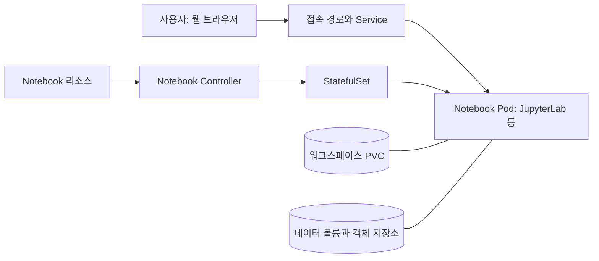
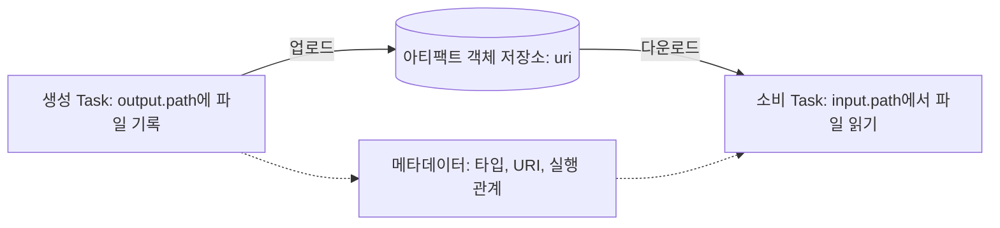
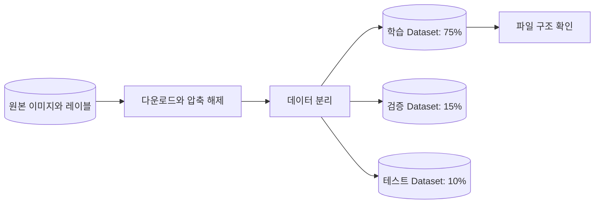
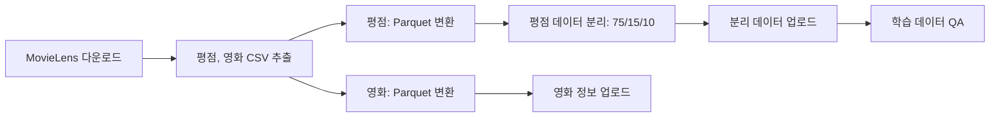

# Data Analysis and Preparation

## From Exploration to Prepared Data

모델을 학습하기 전에 데이터가 해결하려는 문제에 적합한지, 어떤 조건에서 수집됐는지 확인해야 한다. 결측값과 분포를 살피고 레이블의 의미, 데이터 분리 기준, 전처리 방법을 정한다. 이 기준이 명확하지 않으면 학습을 자동화해도 결과를 신뢰하기 어렵다.

7장에서는 신분증 객체 탐지와 영화 추천이라는 두 프로젝트의 데이터 준비를 다룬다. Kubeflow Notebooks에서 데이터를 탐색하고, 반복할 작업을 Kubeflow Pipelines(KFP)의 컴포넌트로 옮긴다. 이 장의 산출물은 다음 학습과 검증 단계에서 사용할 데이터셋이다.

| 프로젝트 | 입력 데이터 | 준비할 내용 |
| --- | --- | --- |
| 신분증 객체 탐지 | 이미지와 객체 위치 레이블 | 이미지와 레이블의 대응 관계, 학습, 검증 데이터와 테스트 데이터 |
| 영화 추천 | 사용자별 영화 평점과 영화 정보 | 평점과 영화 테이블, 저장 형식, 데이터 분리와 품질 검사 |

## Kubeflow Notebook Architecture

[Kubeflow Notebooks](https://www.kubeflow.org/docs/components/notebooks/overview/)는 Kubernetes에서 JupyterLab, code-server, RStudio 등의 대화형 개발 환경을 실행한다. 데이터가 있는 클러스터에서 분석하고 필요한 CPU, 메모리, GPU를 요청할 수 있다. 로컬 장비마다 분석 환경을 따로 구성하는 부담도 줄일 수 있다.

책에서는 Notebook 리소스에 이미지와 자원, 볼륨 등을 선언한다. Notebook Controller는 이 선언에 따라 StatefulSet과 Service를 관리한다. 사용자는 웹으로 접속하고, 코드 실행과 데이터 처리는 노트북 Pod에서 이루어진다.

그림은 Notebook 리소스가 Pod로 만들어지는 과정과 사용자의 접속 경로를 보여준다. 접속 경로와 인증 구성은 설치 방식에 따라 달라진다. KFP를 단독으로 설치했다면 Notebooks UI와 Controller는 별도로 설치해야 한다.

## Workspace and Resource Policies

워크스페이스 볼륨에는 노트북 파일과 작업 내용을 보관하고, 데이터 볼륨에는 분석에 필요한 데이터셋 등을 연결한다. 표준 노트북 이미지에서는 보통 `/home/jovyan`에 워크스페이스 PVC를 마운트한다. Pod를 다시 생성해도 PVC가 유지되면 파일을 다시 사용할 수 있지만, PVC 자체의 삭제와 백업 정책은 별도로 관리해야 한다.

PVC는 스토리지 요청을 나타내며, 여러 Pod에서 동시에 사용할 수 있는지는 스토리지의 접근 모드와 드라이버에 따라 달라진다. 노트북과 파이프라인에 같은 경로 이름을 사용한다고 같은 파일이 보이는 것은 아니다. 각 Pod에 어떤 볼륨을 연결했는지 확인해야 한다.

PodDefault는 같은 네임스페이스에서 레이블이 일치하는 Pod에 환경 변수나 볼륨 등의 설정을 주입하는 데 사용한다. MLflow 주소와 공통 설정을 제공할 수 있으며, KFP 인증에 필요한 토큰 볼륨을 주입하는 [공식 예시](https://www.kubeflow.org/docs/components/pipelines/user-guides/core-functions/connect-api/)도 있다. 접속 주소를 주입하는 것과 실제 접근 권한을 부여하는 것은 별개의 설정이다.

[Node affinity](https://kubernetes.io/docs/concepts/scheduling-eviction/assign-pod-node/)는 노드 레이블을 기준으로 Pod가 실행될 노드를 제한하거나 특정 노드에 우선 배치되도록 설정한다. `required` 조건은 반드시 충족해야 하고, `preferred` 조건은 배치 우선순위에 영향을 준다. [Toleration](https://kubernetes.io/docs/concepts/scheduling-eviction/taint-and-toleration/)은 특정 taint가 있는 노드에도 Pod를 배치할 수 있도록 허용한다. 해당 노드에 배치하도록 지정하는 설정은 아니다.

GPU 요청량과 유휴 종료 정책도 함께 정해야 한다. 노트북을 사용하지 않아도 Pod가 GPU를 예약하고 있으면 다른 작업이 기다릴 수 있다. UI의 기본값과 선택 목록은 사용 편의를 위한 설정이고, 조직의 자원 사용 규칙은 ResourceQuota와 접근 제어 등으로 적용한다.

## Reproducible Notebook Images

노트북과 파이프라인에 같은 베이스 이미지와 의존성 설정을 사용하면 탐색 단계와 반복 실행 단계의 환경 차이를 줄일 수 있다. 노트북 이미지에는 JupyterLab이나 code-server 같은 개발 인터페이스와 이를 실행할 설정을 추가한다.

[공식 이미지 요구사항](https://www.kubeflow.org/docs/components/notebooks/container-images/#image-requirements)에는 HTTP 포트 `8888`, 실행 경로를 전달하는 `NB_PREFIX`, `jovyan` 사용자와 홈 디렉터리 등이 명시되어 있다. 빈 PVC를 홈 디렉터리에 마운트해도 서버가 시작돼야 한다. 실행에 필요한 파일이 마운트 경로에 있으면 볼륨에 가려질 수 있으므로 파일 위치도 확인해야 한다.

분석 중 설치한 패키지는 설치 위치에 따라 Pod 재시작 시 사라지거나 PVC에 남을 수 있다. PVC에 남은 패키지가 이미지의 패키지를 덮어쓸 수도 있으므로, 재현할 의존성은 이미지 빌드 정의로 옮긴다. 이미지 버전과 코드 커밋, 데이터 버전도 함께 기록한다.

카카오페이의 [2025년 Kubeflow 기반 AI 플랫폼 구축기](https://tech.kakaopay.com/post/ai-platform/)는 수작업과 환경 차이를 줄이기 위해 컨테이너와 파이프라인을 표준화한 사례다. 일반 워커 노드와 GPU 노드의 역할을 구분하고, GPU 할당량과 유휴 자원을 관찰했다. 노트북의 실행 환경과 자원 정책도 이런 공통 플랫폼 운영의 일부로 볼 수 있다.

## Parameters and Artifacts

KFP의 컴포넌트는 별도의 컨테이너에서 실행되므로 메모리의 Python 객체나 임의의 로컬 파일을 다음 작업에서 그대로 사용할 수 없다. 입력과 출력의 성격에 맞춰 전달 방식을 정해야 한다.

| 전달 방식 | 사용할 대상 | 주의할 점 |
| --- | --- | --- |
| Parameter | 문자열, 숫자, 분리 비율, 난수 시드 등 작은 값 | 대용량 데이터 본문을 넣으면 실행 인자나 메타데이터 크기 제한에 걸릴 수 있음 |
| Artifact | 데이터셋, 이미지 묶음, 모델, 보고서 등 산출물 | 파일을 저장하고 아티팩트 입력과 출력을 연결해야 함 |
| 외부 저장소 URI | 이미 저장된 데이터의 위치 | 문자열로 위치를 전달하면 접근, 다운로드, 버전 관리를 코드에서 처리해야 함 |

5장에서 살펴본 출력 연결에서 Parameter는 값을 전달하고, 파일 기반 Artifact는 저장소를 통해 파일을 전달한다. [공식 아티팩트 문서](https://www.kubeflow.org/docs/components/pipelines/user-guides/data-handling/artifacts/)에서 `.path`는 작업 컨테이너의 로컬 경로, `.uri`는 저장소의 위치, `.metadata`는 추가 속성을 나타낸다.

이 그림은 책에서 사용하는 KFP v2의 객체 저장소 기반 파일 전달을 나타낸다. 앞선 작업이 지정된 출력 경로에 파일이나 디렉터리를 만들면 KFP 런타임이 저장소에 업로드한다. 다음 작업이 실행될 때는 해당 파일을 읽을 수 있는 입력 경로가 준비된다. 임의의 `/tmp/data.csv` 경로를 문자열로 반환하는 것만으로 파일이 다른 Pod에 복사되지는 않는다.

입력 아티팩트는 변경하지 않고 새 결과를 출력 아티팩트로 기록한다. 이렇게 하면 어느 실행의 어떤 입력에서 산출물이 만들어졌는지 추적할 수 있다. 사용자 코드에서 별도 MinIO 버킷에 업로드하는 작업과 KFP가 관리하는 아티팩트 전송도 구분해야 한다.

## Component Execution and Artifact Types

책의 [경량 Python 컴포넌트](https://www.kubeflow.org/docs/components/pipelines/user-guides/components/lightweight-python-components/)는 Python 함수로 작성한다. 컴파일된 명세에는 함수 코드와 입출력 정의, 컨테이너 이미지와 실행 명령, Task 사이의 연결이 담긴다. 데이터 처리는 컴파일 시점이 아니라 파이프라인 실행 시점에 이루어진다.

경량 컴포넌트에서는 함수 내부에 필요한 import를 두고 외부 전역 변수나 노트북 상태에 의존하지 않도록 작성한다. 패키지는 베이스 이미지에 포함하거나 `packages_to_install`로 지정할 수 있다. 반복 실행할 작업이라면 필요한 패키지를 이미지에 미리 설치하고 버전을 고정한다. 실행할 때마다 설치하는 시간을 줄이고 같은 환경을 재사용할 수 있다.

| 아티팩트 타입 | 표현하는 산출물 |
| --- | --- |
| Artifact | 특정 의미를 지정하지 않은 일반 산출물 |
| Dataset | 데이터셋 |
| Model | 학습된 모델 |
| Metrics | 정확도와 학습 시간 등의 수치 지표 |
| ClassificationMetrics | 혼동 행렬과 ROC 등의 분류 평가 정보 |
| SlicedClassificationMetrics | 데이터 구간별 분류 평가 정보 |
| HTML / Markdown | 시각화 보고서와 설명 문서 |

이 타입들은 연결되는 산출물의 의미와 UI 표시 방법을 나타낸다. `Dataset`으로 선언해도 CSV와 Parquet 사이의 변환이나 데이터 품질 검사가 자동으로 수행되지는 않는다. 파일 형식과 스키마는 컴포넌트가 정하고 검증해야 한다. Metrics처럼 메타데이터에 지표를 기록하는 타입도 있어 모든 아티팩트가 데이터 파일을 만드는 것은 아니다.

## Preparing Object Detection Data

신분증 탐지 데이터에는 이미지와 함께 객체의 클래스 및 위치를 나타내는 레이블이 필요하다. [Ultralytics의 YOLO 데이터 형식](https://docs.ultralytics.com/datasets/detect/)은 이미지에 대응하는 텍스트 레이블에 클래스 ID와 정규화된 중심 좌표, 너비, 높이를 기록한다. 이미지와 레이블의 파일명, 클래스 정의, 좌표 범위를 함께 확인해야 한다.

[저자의 데이터 준비 파이프라인](https://github.com/practical-mlops/object-detection-project/blob/main/data_prep_pipeline.py)은 데이터를 다운로드해 압축을 풀고, 데이터를 분리한 뒤 파일 구조를 확인한다. 학습, 검증, 테스트 데이터의 비율은 각각 75%, 15%, 10%이며 난수 시드를 입력으로 받는다.

공개 코드의 파일 구조 확인 Task는 학습 데이터셋에 연결되어 있다. 전체 품질을 확인하려면 검증 데이터와 테스트 데이터도 검사해야 한다. 이미지와 레이블은 파일명을 기준으로 짝짓는다. 각각 수집한 파일 목록의 순서에만 의존하면 다른 이미지의 레이블이 연결될 수 있다.

같은 신분증이나 연속 촬영 이미지가 여러 분할에 섞이면 평가가 지나치게 좋아질 수 있다. 실제 데이터에서는 촬영 대상이나 수집 단위를 기준으로 분리할 필요가 있는지 판단한다. 분리 비율과 시드에 더해 각 분할의 파일 목록도 남기면 다음 학습에서 같은 데이터를 사용할 수 있다.

## Preparing Movie Recommendation Data

[MovieLens 25M](https://grouplens.org/datasets/movielens/25m/)은 약 2,500만 건의 평점을 포함한 추천 시스템용 데이터셋이다. 이 프로젝트에서는 `ratings.csv`와 `movies.csv`를 사용한다. 평점 데이터는 사용자 ID, 영화 ID, 평점, 시각을 담고, 영화 데이터는 영화 ID와 제목과 장르를 담는다.

[저자의 파이프라인](https://github.com/practical-mlops/movie-recommender-project/blob/main/01_data_preparation_pipeline.py)은 6종의 컴포넌트로 8개 Task를 구성한다. 형식 변환 컴포넌트는 평점과 영화 테이블에 각각 사용한다. 업로드 컴포넌트도 영화 정보와 분리된 평점 데이터를 저장하는 데 각각 사용한다.

[Parquet](https://parquet.apache.org/docs/overview/)은 데이터를 열 단위로 저장해 압축하거나 필요한 열만 읽기에 적합하다. 변환할 때 열 이름과 자료형을 명시하고, 평점 테이블의 영화 ID가 영화 정보와 연결되는지 검사한다. 사용자 ID와 영화 ID는 수치 피처로 취급하지 않도록 구분하고, 평점 범위와 타임스탬프가 나타내는 시각도 확인한다.

공개 코드의 [QA 컴포넌트](https://github.com/practical-mlops/movie-recommender-project/blob/main/data_components/dataset_preparation.py)는 업로드된 학습 데이터의 열 수와 최소 행 수를 검사한다. 영화 정보 업로드가 끝날 때까지 기다리도록 설정하지 않았으며, 검증 데이터와 테스트 데이터의 품질 검사도 포함하지 않는다. 원본 MovieLens의 열 이름은 `userId`와 `movieId`지만 분리 코드는 `user_id`와 `item_id`를 참조하므로, 실행 전에 열 이름을 맞춰야 한다.

추천 시스템의 데이터 분리 기준은 평가하려는 상황에 따라 달라진다. 공개 코드는 평점 행을 무작위로 나눈다. 향후 추천 성능을 평가하려면 과거 데이터로 학습하고 이후 데이터로 검증하는 방법도 검토한다. 기존 사용자 대상의 추천과 신규 사용자나 영화가 포함된 추천은 평가 조건을 구분해야 한다.

## Validating Prepared Datasets

데이터 준비가 끝났는지는 파일 생성 여부와 데이터 내용을 함께 확인해 판단한다. 필수 열과 자료형, 결측값, 값의 범위, 중복, 데이터 간 참조 관계를 검사한다. 객체 탐지에서는 레이블과 이미지의 대응을, 추천에서는 사용자, 영화, 평점의 관계를 점검한다.

원본 데이터의 버전이나 체크섬, 처리 코드와 이미지 버전, 전처리 설정, 분할 목록과 검사 결과를 함께 기록한다. 저장 경로를 실행별로 구분하면 이전 결과를 덮어쓰거나 다른 실행의 데이터를 읽는 문제를 줄일 수 있다. 다음 장에서는 이 기록을 바탕으로 학습과 검증 결과가 어떤 데이터 준비 조건에서 나왔는지 확인할 수 있다.

## Version Changes and Lab Adaptations

본문은 책에서 사용한 Notebook 리소스 기반 분석 환경과 KFP v2의 데이터 전달 개념을 설명한다. 2026년 11월 7일에 확인한 주요 변경 사항과 실습 적용 방향은 다음과 같다.

| 책의 구성과 개념 | 현재 상태와 실습 적용 |
| --- | --- |
| Kubeflow Notebooks와 Notebook Controller | [Community Distribution 26.10.0](https://github.com/kubeflow/community-distribution/releases/tag/26.10.0)은 Workspaces 2.0.0(Notebooks v2)을 기본으로 제공한다. Notebooks v1은 선택적으로 설치할 수 있지만 27.03 배포판에서 제외될 예정이다. 실습에서는 Workspaces로 분석 환경을 구성한다. |
| Notebook 생성 UI, PodDefault, 기본값 설정 | 실습에서는 [Workspace와 WorkspaceKind](https://www.kubeflow.org/docs/components/workspaces/overview/)에 맞춰 이미지, 자원, Pod 설정을 정의한다. 책의 Notebook CR과 UI 설정은 새 구조에 맞게 옮긴다. PodDefault는 현재도 제공된다. |
| 자료에서 비교하는 KFP v1 컴포넌트 API | `ContainerOp`, `create_component_from_func` 등은 [v2 SDK에서 제거](https://www.kubeflow.org/docs/components/pipelines/user-guides/migration/)되었다. 실습은 `@dsl.component` 또는 `@dsl.container_component`로 작성한다. |
| Parameter, Artifact, `.path`, `.uri` | [현재 KFP v2에서도 유지](https://www.kubeflow.org/docs/components/pipelines/user-guides/data-handling/artifacts/)되는 개념이다. `Input[Dataset]`과 `Output[Dataset]` 등으로 데이터 전달을 명시한다. |

자료에 제시된 KFP SDK 2.9.0과 백엔드 2.4.1의 실행 결과는 해당 환경에서 확인한 내용이다. 기본 Python 이미지와 컴파일된 실행 명령은 버전에 따라 달라질 수 있다. 값을 전달하다 실패한 데이터 크기도 실행 환경에 따라 달라진다. 향후 `labs/*` 실습에서는 Python 3.12와 KFP v2를 사용하고, SDK와 백엔드 버전 및 컨테이너 이미지를 고정한 뒤 동작을 확인할 예정이다.
